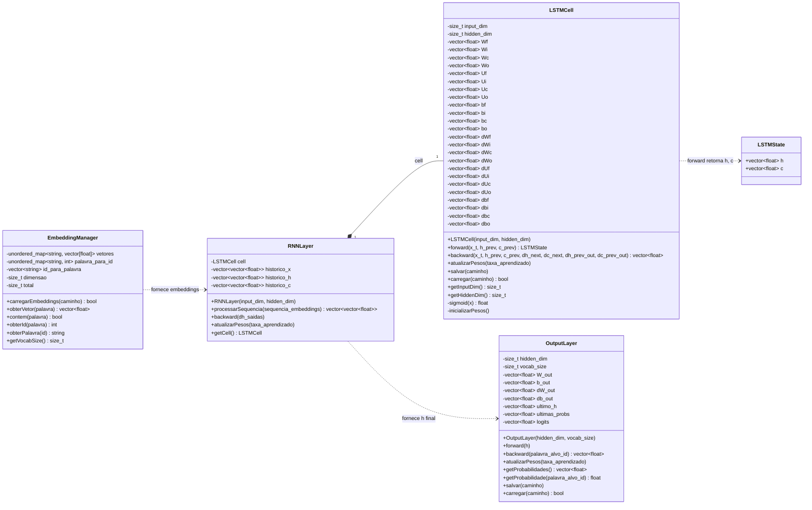
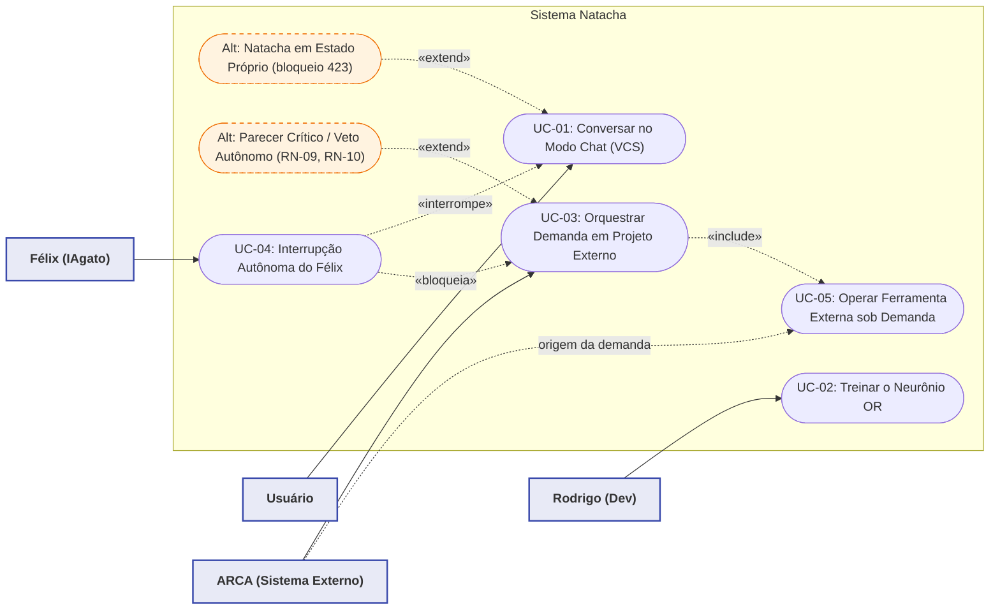
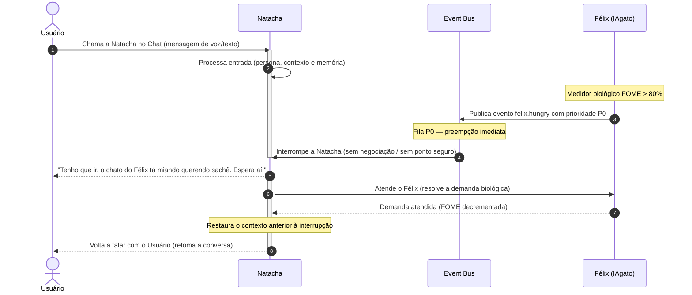
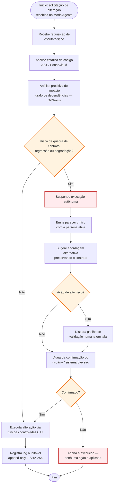
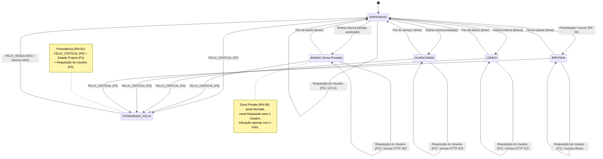
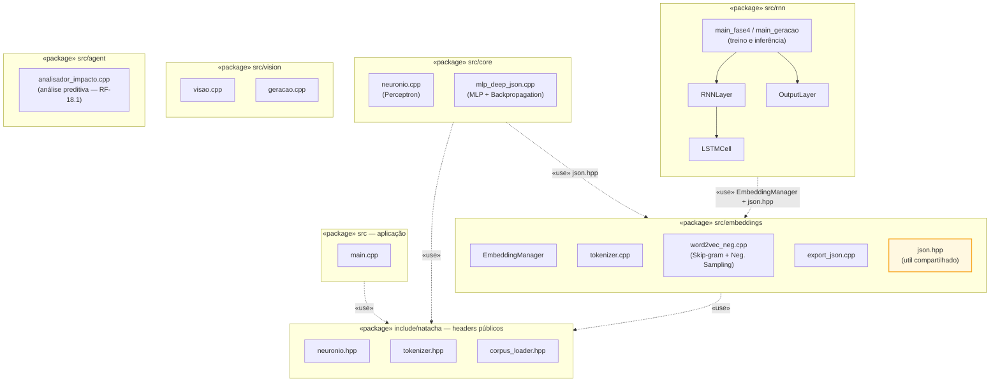
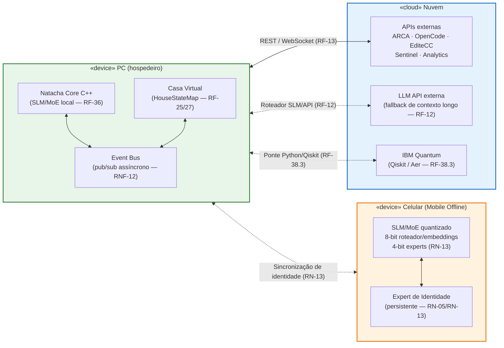
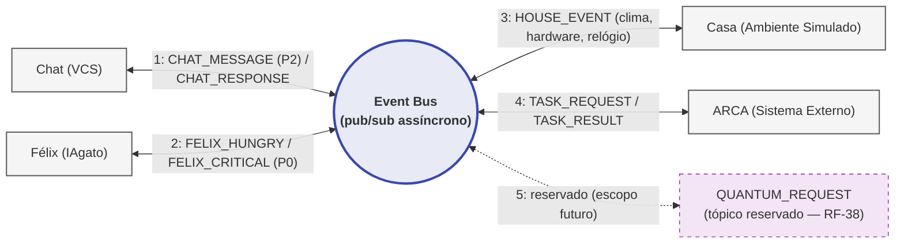
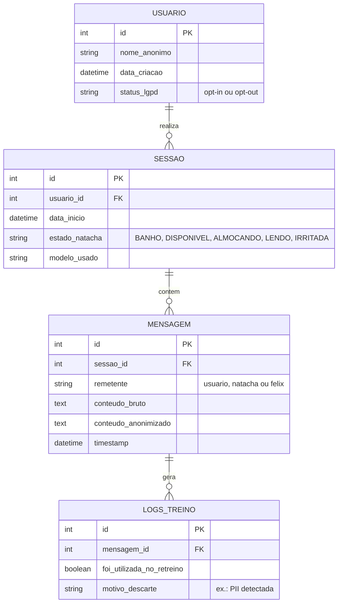

# Diagramas do Projeto Natacha

Este documento centraliza os diagramas de arquitetura do projeto Natacha. Todos os diagramas são **gerados via código (Mermaid)** e embutidos diretamente no Markdown, garantindo que a documentação permaneça **sempre sincronizada com o código C++**: qualquer refatoração nas classes (`LSTMCell`, `RNNLayer`, `OutputLayer`, `EmbeddingManager`) pode ser refletida aqui editando-se apenas texto versionável junto ao fonte — sem ferramentas gráficas externas, sem binários e sem divergência entre modelo e implementação.

Os diagramas podem ser visualizados diretamente no GitHub, no VS Code (extensão Mermaid) ou em [mermaid.live](https://mermaid.live).

## 1. Diagrama de Classes (Núcleo Neural)

Diagrama das classes do núcleo neural (Fase 4 — RNN/LSTM com BPTT, conforme RF-32 de `docs/REQUISITOS.md`). A `RNNLayer` **compõe** uma `LSTMCell` (membro por valor), e as setas tracejadas representam o fluxo de dados do pipeline de treinamento orquestrado pelo loop principal (`main_fase4.cpp`): embeddings alimentam a `RNNLayer`, cujo estado oculto final (`h`) alimenta a `OutputLayer`.

> Nota: em Mermaid, tipos genéricos usam `~` (ex.: `vector~float~` renderiza como `vector<float>`), pois colchetes angulares literais são interpretados como HTML.

## 2. Diagrama de Casos de Uso (UML)

Casos de uso principais (UC-01 a UC-05, conforme seção 5 de `docs/REQUISITOS.md`) e seu mapeamento para os atores: **Usuário**, **Rodrigo (Dev)**, **Félix (IAgato)** e **ARCA (Sistema Externo)**.

Observações de modelagem:

- **UC-05** é executado autonomamente pela própria Natacha (agência própria, RN-01); entre os atores externos, o **ARCA é a origem da demanda** (RF-11.1), por isso a associação tracejada e o `«include»` a partir de UC-03.
- Os fluxos alternativos foram modelados com `«extend»`: **Estado Próprio** em UC-01 (RF-04/RN-02, HTTP 423) e **Parecer Crítico / Veto Autônomo** em UC-03 (RF-18.1/18.2, RN-09/RN-10).
- As relações `«interrompe»` e `«bloqueia»` representam a autoridade P0 do Félix (RN-03) sobre o chat (UC-01) e sobre operações do Modo Agente (UC-03).

## 3. Diagrama de Sequência — Interrupção P0 do Félix

Fluxo do UC-04 (Interrupção Autônoma do Félix): o índice biológico `FOME` ultrapassa 80%, o Félix publica `felix.hungry` com prioridade **P0** no Event Bus, que preempta a Natacha imediatamente (RN-03/RF-19.1, sem negociação e sem ponto seguro). A Natacha avisa o Usuário, atende a demanda do Félix e retoma a conversa restaurando o contexto interrompido.

## 4. Diagrama de Atividades — Análise Preditiva de Impacto (RF-18.1)

Fluxo de decisão obrigatório antes de qualquer escrita/edição no Modo Agente (RN-09 / RF-18.1 / RN-12): análise estática (AST/SonarCloud) + análise do grafo de dependências (GitNexus). Sem risco, executa via funções controladas e registra log auditável; com risco, suspende a execução, emite parecer crítico com a persona, sugere alternativa preservando o contrato e, em ações de alto risco, exige validação humana (RF-18) antes de qualquer confirmação.

## 5. Diagrama de Máquina de Estados — Estados da Natacha

Estados internos da rotina independente (RN-02) e transições. Requisições do Usuário durante Estados Próprios são rejeitadas (HTTP 423, RF-04), exceto `FELIX_CRITICAL` (P0), que preempta **qualquer** estado (RN-03). O `BANHO` é Zona Privada (RN-08): canal bloqueado para o Usuário, interação apenas com o Félix. Precedência: `FELIX_CRITICAL (P0) > Estado Próprio (P1) > Requisição do Usuário (P2)`.

## 6. Diagrama de Pacotes — Estrutura de Pastas

Estrutura real do repositório (`src/` + `include/`) e dependências extraídas dos `#include` do código. Destaques: `src/rnn` depende de `src/embeddings` (`EmbeddingManager.hpp` e o utilitário compartilhado `json.hpp`); `src/core` também consome `json.hpp`; `src/vision` e `src/agent` são autocontidos; os headers públicos ficam em `include/natacha/`.

## 7. Diagrama de Implantação — PC, Celular e Nuvem

Nós de execução do sistema: **PC** (core C++ local com inferência SLM/MoE, Event Bus e Casa Virtual — RF-36/RNF-12), **Celular** (inferência offline com quantização mista e Expert de Identidade persistente — RN-13/RF-41) e **Nuvem** (APIs externas via REST/WebSocket — RF-13, LLM API de fallback — RF-12 e IBM Quantum via ponte Python/Qiskit — RF-38.3).

## 8. Diagrama de Comunicação — Event Bus (Hub Central)

O Event Bus é o hub de comunicação assíncrona que desacopla todos os módulos core (RNF-12/RN-07). Os módulos **Chat**, **Félix**, **Casa** e **ARCA** publicam e assinam tópicos com prioridades distintas; a numeração ilustra uma sequência representativa — a mensagem do Chat (P2) é preemptada pelo `FELIX_HUNGRY` (P0), como detalhado na seção 3. O tópico `QUANTUM_REQUEST` fica reservado para o Sótão Quântico (RF-38).

## 9. Diagrama de Banco de Dados (Fase 7)

Modelo Entidade-Relacionamento do banco de retreinamento. Relações 1:N: `USUARIO → SESSAO → MENSAGEM` (e `MENSAGEM → LOGS_TREINO`, que registra se cada mensagem foi aproveitada ou descartada no retreino).

> **Nota (LGPD):** os dados passam por um **script de anonimização antes de entrar no banco** — PII (nomes, telefones, e-mails, documentos) é detectada e mascarada/substituída, gerando o `conteudo_anonimizado`. O `conteudo_bruto` só é retido quando o `status_lgpd` do usuário é **opt-in**; em **opt-out**, a mensagem não é persistida para retreino. Mensagens com PII residual são registradas em `LOGS_TREINO.motivo_descarte` ("PII detectada") e excluídas do treinamento (`foi_utilizada_no_retreino = false`).

